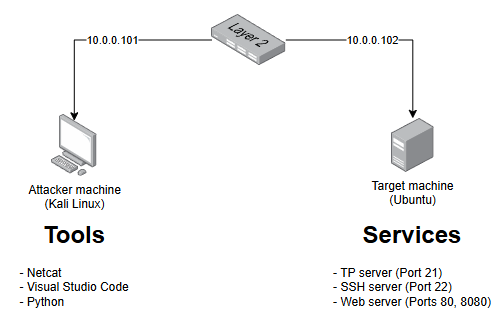

# **Home Lab: Building a Basic Port Scanner with Python**

**Project:** TCP Port Scanner

**Author:** César Asto Oré

**Creation date:** 06-set-2026

## Overview

This first cybersecurity home lab consists of querying the state of connections to a target machine through TCP ports. It covers configuring the target machine so that it can be scanned by the attacker machine. Basic services such as web, SSH, and FTP will be exposed.

## Architecture



## Toolbox
- Kali Linux: attacker machine
- Ubuntu Desktop: target machine
- Visual Studio Code: code editor
- Python: scripting language

## Implementation

### Target Machine

Comenzamos comprobando la conexión con la máquina atacante usando el comando "ping". Seguido, consultamos las conexiones activas en nuestra máquina con el comando "ss". Para este laboratorio, instalamos 3 servicios: ssh, web y ftp.

>**ss** is used to dump socket statistics. It allows showing information similar to netstat. It can display more TCP and state information than other tools.
>
>OPTIONS
>
>-n, --numeric :    *Do not try to resolve service names. Show exact bandwidth values, instead of human-readable.*
>
>-l, --listening :  *Display only listening sockets (these are omitted by default).*
>
>-p, --processes :  *Show process using socket.*
>
>-t, --tcp       :  *Display TCP sockets.*

```plaintext
ubuntu@StevensUbuntu:~$ ping -c 4 10.0.0.101
ubuntu@StevensUbuntu:~$ sudo ss -tlnp
State   Recv-Q   Send-Q   Local Address:Port      Peer Address:Port   Process
LISTEN  0        4096     127.0.0.54:53           0.0.0.0:*           users:(("systemd-resolve",pid=415,fd=19))
LISTEN  0        4096     127.0.0.1:631           0.0.0.0:*           users:(("cupsd",pid=1261,fd=7))
LISTEN  0        4096     127.0.0.53%lo:53        0.0.0.0:*           users:(("systemd-resolve",pid=415,fd=17))
LISTEN  0        4096     [::1]:631               [::]:*              users:(("cupsd",pid=1261,fd=6))

ubuntu@StevensUbuntu:~$ sudo apt install openssh-server apache2 vsftpd

ubuntu@StevensUbuntu:~$ systemctl status ssh
○ ssh.service - OpenBSD Secure Shell server
     Active: inactive (dead)

ubuntu@StevensUbuntu:~$ systemctl status apache2
● apache2.service - The Apache HTTP Server
     Active: active (running) since Sun 2026-09-06 16:42:53 -05; 24min ago

Sep 06 16:42:53 StevensUbuntu systemd[1]: Starting apache2.service - The Apache...
Sep 06 16:42:53 StevensUbuntu apachectl[6046]: AH00558: apache2: Could not reli...
Sep 06 16:42:53 StevensUbuntu systemd[1]: Started apache2.service - The Apache ...

ubuntu@StevensUbuntu:~$ systemctl status vsftpd
● vsftpd.service - vsftpd FTP server
     Active: active (running) since Sun 2026-09-06 16:43:05 -05; 24min ago

Sep 06 16:43:05 StevensUbuntu systemd[1]: Starting vsftpd.service - vsftpd FTP...
Sep 06 16:43:05 StevensUbuntu systemd[1]: Started vsftpd.service - vsftpd FTP s...

ubuntu@StevensUbuntu:~$ sudo ss -tlnp
State   Recv-Q   Send-Q   Local Address:Port      Peer Address:Port   Process
LISTEN  0        4096     127.0.0.54:53           0.0.0.0:*           users:(("systemd-resolve",pid=415,fd=19))
LISTEN  0        4096     127.0.0.1:631           0.0.0.0:*           users:(("cupsd",pid=1261,fd=7))
LISTEN  0        4096     127.0.0.53%lo:53        0.0.0.0:*           users:(("systemd-resolve",pid=415,fd=17))
LISTEN  0        4096     0.0.0.0:22              0.0.0.0:*           users:(("sshd",pid=9046,fd=3),("systemd",pid=1,fd=156))
LISTEN  0        4096     [::1]:631               [::]:*              users:(("cupsd",pid=1261,fd=6))
LISTEN  0        511      *:80                    *:*                 users:(("apache2",pid=6063,fd=4),("apache2",pid=6062,fd=4),("apache2",pid=6046,fd=4))
LISTEN  0        4096     [::]:22                 [::]:*              users:(("sshd",pid=9046,fd=4),("systemd",pid=1,fd=157))
LISTEN  0        32       *:21                    *:*                 users:(("vsftpd",pid=6869,fd=3))

ubuntu@StevensUbuntu:~$ sudo ufw allow 21/tcp
ubuntu@StevensUbuntu:~$ sudo ufw allow 22/tcp
ubuntu@StevensUbuntu:~$ sudo ufw allow 80/tcp
ubuntu@StevensUbuntu:~$ sudo ufw reject 8080/tcp
ubuntu@StevensUbuntu:~$ sudo ufw enable

ubuntu@StevensUbuntu:~$ sudo ufw status
Status: active

To              Action      From
--              ------      ----
22/tcp          ALLOW       Anywhere
21/tcp          ALLOW       Anywhere
80/tcp          ALLOW       Anywhere
8080/tcp        REJECT      Anywhere
22/tcp (v6)     ALLOW       Anywhere (v6)
21/tcp (v6)     ALLOW       Anywhere (v6)
80/tcp (v6)     ALLOW       Anywhere (v6)
8080/tcp (v6)   REJECT      Anywhere (v6)
```

### Attacker Machine

De igual forma, comprobamos conectividad con la máquina objetivo usando el comando "ping", a fin de evitar problemas de configuración de red.
A continuación, utilizamos la herramienta "netcat" ("nc") para conocer el estado de conexión de los puertos.

>**netcat** is a simple Unix utility which reads and writes data across network connections, using TCP or UDP protocol. It is designed to be a reliable  "back-end"  tool  that can be used directly or easily driven by other programs and scripts. At the same time, it is a feature-rich network  debugging and exploration tool, since it can create almost any kind of connection you would need and has several interesting  built-in capabilities.   Netcat,  or "nc" as the actual program is named, should have been supplied long ago as another one of those cryptic  but  standard Unix tools.
>
>OPTIONS
>
>-v           verbose [use twice to be more verbose]
>
>-z           zero-I/O mode [used for scanning]

```plaintext
┌──(kali㉿kali)-[~]
└─$ ping -c 4 10.0.0.102

┌──(kali㉿kali)-[~]
└─$ nc -zv 10.0.0.102 21
10.0.0.102: inverse host lookup failed: Host name lookup failure
(UNKNOWN) [10.0.0.102] 21 (ftp) open

┌──(kali㉿kali)-[~]
└─$ nc -zv 10.0.0.102 22
10.0.0.102: inverse host lookup failed: Host name lookup failure
(UNKNOWN) [10.0.0.102] 22 (ssh) open

┌──(kali㉿kali)-[~]
└─$ nc -zv 10.0.0.102 80
10.0.0.102: inverse host lookup failed: Host name lookup failure
(UNKNOWN) [10.0.0.102] 80 (http) open

┌──(kali㉿kali)-[~]
└─$ nc -zv 10.0.0.102 53 
10.0.0.102: inverse host lookup failed: Host name lookup failure
(UNKNOWN) [10.0.0.102] 53 (domain) : Connection refused

┌──(kali㉿kali)-[~]
└─$ nc -zv 10.0.0.102 631
10.0.0.102: inverse host lookup failed: Host name lookup failure
(UNKNOWN) [10.0.0.102] 631 (ipp) : Connection refused

┌──(kali㉿kali)-[~]
└─$ nc -zv 10.0.0.102 8080
10.0.0.102: inverse host lookup failed: Host name lookup failure
(UNKNOWN) [10.0.0.102] 8080 (http-alt) : Connection refused

┌──(kali㉿kali)-[~]
└─$ nc -zv 10.0.0.102 9999
10.0.0.102: inverse host lookup failed: Host name lookup failure
(UNKNOWN) [10.0.0.102] 9999 (?) : Connection refused

```

After adding rules in firewall:

```plaintext
┌──(kali㉿kali)-[~]
└─$ nc -zv 10.0.0.102 21
10.0.0.102: inverse host lookup failed: Host name lookup failure
(UNKNOWN) [10.0.0.102] 21 (ftp) open

┌──(kali㉿kali)-[~]
└─$ nc -zv 10.0.0.102 8080
10.0.0.102: inverse host lookup failed: Host name lookup failure
(UNKNOWN) [10.0.0.102] 8080 (http-alt) : Connection refused

┌──(kali㉿kali)-[~]
└─$ nc -zv 10.0.0.102 9999
10.0.0.102: inverse host lookup failed: Host name lookup failure
(UNKNOWN) [10.0.0.102] 9999 (?) : Connection timed out
```

## Results

With the Python script, we built a program that queries the state of the target server's ports. The results show that ports 21, 22, and 80 are open, while port 8080 was refused and port 9999 timed out.

```plaintext
ubuntu@StevensUbuntu:~$ python3 ~/Projects/PortScanner/PortScanner.py
TCP Port Scanner.
Enter the target IP address and the ports you want to scan (comma-separated).
Target IP: 10.0.0.102
Ports: 21,22,80,8080,9999

Scanning 10.0.0.102...

Port 21: open
Port 22: open
Port 80: open
Port 8080: refused
Port 9999: timeout
```

## Lessons learned

- There are differences between the "reject" and "deny" firewall actions, so it is necessary to understand the behavior of each one: with "reject", the firewall actively answers the connection attempt with a TCP RST, so the scanner receives an immediate "connection refused" and reports the port as closed, whereas with "deny", the firewall silently drops the packet without any response, so the scanner waits until its timeout expires and reports the port as filtered.

## Next steps

- Implement validation for network port input.
- Implement handling for connection losses.
